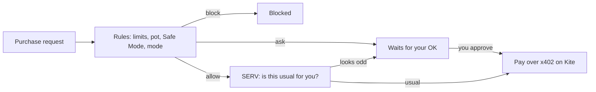

# Reins

**Spend on autopilot. Keep the reins.**

Reins is an AI agent that learns your spending habits, pays for the ones you switch on within hard limits you set, and gets careful on its own when money runs low. It uses **SERV Reasoning** for judgment and pays real merchants over **x402 on Kite**.

Built for the OpenServ SERV Hackathon, Edition 02 (Kite track).

## What it does

1. **Learns your habits.** Upload a bank statement (CSV) or connect a wallet read-only. Reins finds your recurring spending: what, how much, which day and the usual time ("Coffee: about $4.13 most weekdays at 8:10 am").
2. **You choose what it may pay.** Every habit starts switched off. Switch on the ones you want handled and set a hard limit for each.
3. **You choose how much it asks.** *Ask me every time*, *Trust ladder* (a habit earns autopilot after 3 approvals in a row) or *Full autopilot*.
4. **Safe Mode.** If your wallet can't cover the next 2 weeks of bills plus your safety floor, Reins pauses lifestyle spending and asks before everything else. You can also switch it on yourself.
5. **Ask for anything.** "Get me a ride home" or "Order lunch under $15" goes through the same checks.
6. **Pays on Kite.** Approved purchases are paid over x402 to demo shops on Kite's test network, and every payment links to KiteScan.
7. **You fund it, it never pulls.** Reins spends only from its spending pot. To add money you send to the pot's deposit address (copy it or scan the QR) from any wallet, and Reins confirms when it arrives on-chain.

## How a purchase is decided



- **Rules first** (`src/lib/engine.ts`). Limits, pot balance, Safe Mode and your control mode. All money math is plain code, so it's exact.
- **SERV second** (`src/app/api/decide/route.ts`). If the rules allow a purchase, SERV checks whether it looks usual for this person. SERV can only make a decision stricter, turning *allow* into *ask*, never the other way round.
- SERV also reviews detected habits (clear names, bill vs lifestyle, "forgotten subscription?") and turns plain requests like "Buy my usual coffee" into a merchant, amount and habit.

## How a payment works (x402 on Kite)

1. Reins asks the shop for the item.
2. The shop replies **402 Payment Required** with the price, token and where to pay.
3. Reins checks the price is no more than what was approved, then pays from its agent wallet on Kite.
4. Reins asks again with an `X-PAYMENT` header; the shop verifies the payment on-chain and confirms the order.

Four demo shops (Reins Coffee, Rides, Eats and Store) live at `/api/shops/[shop]`. The **Shops** page shows the orders each one received and the money in the shops' wallet. On testnet each payment is 1/100 of the price (`KITE_PAY_SCALE`), so a little faucet money covers a whole demo.

## Run it locally

```bash
npm install
cp .env.example .env.local   # Windows PowerShell: copy .env.example .env.local
npm run dev
```

Open http://localhost:3000 and click **Try the sample statement**.

With no keys set, everything runs in mock mode: SERV answers are simulated and payments are fake, so nothing costs money. Add a `SERV_API_KEY` to use SERV for real. For live Kite payments, set `PAYMENTS_MODE=kite` and an agent wallet key, then fund that wallet with test USDT and a little KITE for fees from [faucet.gokite.ai](https://faucet.gokite.ai). See `.env.example` for every setting.

## Project map

| Path | What it does |
| --- | --- |
| `src/components/ReinsApp.tsx` | All screens: landing, dashboard, approvals, activity, shops, settings |
| `src/lib/statement.ts` | Reads bank statement CSVs, including transaction times |
| `src/lib/walletHistory.ts` | Reads a wallet's on-chain payments from KiteScan |
| `src/lib/habits.ts` | Finds recurring spending, its cadence and usual time |
| `src/lib/engine.ts` | Rules, limits, trust ladder, Safe Mode |
| `src/lib/serv.ts` | SERV Reasoning client |
| `src/lib/payments.ts` | Payment providers: mock, and x402 on Kite |
| `src/lib/shops.ts` | Demo shops: payment terms and on-chain verification |
| `src/lib/wallet.ts` | Kite testnet chain and read-only balances |
| `src/app/api/statement` | Statement or wallet → habits (with SERV review) |
| `src/app/api/parse-request` | Plain-language request → purchase (SERV) |
| `src/app/api/decide` | Rules + SERV decision |
| `src/app/api/pay` | Pays a purchase |
| `src/app/api/shops/[shop]` | The x402 demo shops |
| `src/app/api/wallet`, `status` | Balances and which modes are live |
| `src/app/api/selftest` | Protected end-to-end check of the live app |

Built with Next.js 16, React 19, TypeScript, Tailwind CSS v4 and viem.

## Honest limits and what's next

- **One shared demo pot.** Everyone trying the demo spends from the same agent wallet. Next: each user gets their own pot through **Kite Agent Passport**, which signs payments within limits Kite enforces.
- **Funding.** Today you deposit test USDT on Kite. Next: automatic top-ups within a weekly cap, deposits from other chains (Passport already offers deposit addresses on Base, Solana, Polygon, Avalanche and more), and card or bank top-ups for people who don't hold crypto.
- **Real merchants.** Uber, airlines and food apps don't accept agent payments yet, so the demo uses x402 shops. Reins works with any merchant that accepts x402.
- **Your data stays in your browser.** There are no accounts yet, so Reins only runs while the page is open. Next: sign-in, so it can pay on schedule with the browser closed.
